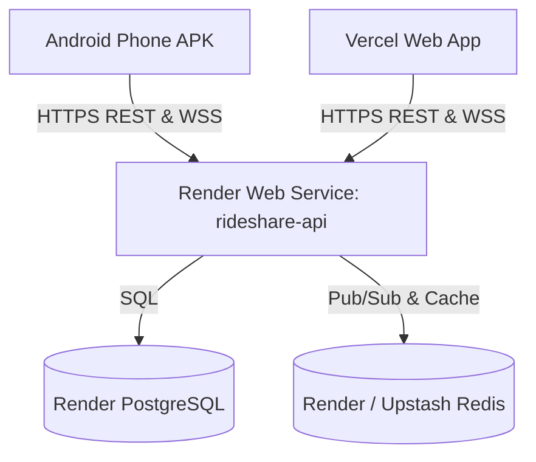

# 🚀 RideShare Deployment Guide: Render & Vercel

This document guides you step-by-step through deploying:
1. **Backend API, PostgreSQL & Redis** on **Render**
2. **Frontend Web App** on **Vercel**
3. **Android Mobile App (APK)** connecting live to your hosted backend

---

## 🏗️ Architecture Overview



---

## Part 1: Deploying Backend to Render

### Option A: 1-Click Render Blueprint (Recommended)

The repository includes a ready-to-use [`render.yaml`](./render.yaml) blueprint that automatically provisions:
- A Node.js Fastify/NestJS Web Service (`rideshare-api`)
- A managed PostgreSQL Database (`rideshare-postgres`)
- A managed Redis instance (`rideshare-redis`)

**Steps:**
1. Log into your [Render Dashboard](https://dashboard.render.com).
2. Click **New +** in the top right corner and choose **Blueprint**.
3. Connect your GitHub repository: `Blackwrld04/RIdeShare`.
4. Render will parse `render.yaml` and display the service plan.
5. Click **Apply**.
6. Render will automatically:
   - Install dependencies (`npm install --legacy-peer-deps`)
   - Generate the Prisma Client (`npm run prisma:generate`)
   - Build shared packages (`npm run build:packages`)
   - Run database migrations (`npm run db:deploy`)
   - Start the API server on port `10000` listening on `0.0.0.0`
7. Once deployed, Render provides your live URL:
   ```
   https://rideshare-api.onrender.com
   ```
   Your API endpoint will be:
   ```
   https://rideshare-api.onrender.com/api/v1
   ```
   You can verify it by opening `https://rideshare-api.onrender.com/api/v1/health` in your browser.

---

### Option B: Free Tier Setup (Using Free Cloud Redis / Upstash)

Render's free tier includes free Web Services and free PostgreSQL, but managed Redis requires Starter ($7/mo). If you prefer 100% free hosting:

1. Create a free Redis instance on [Upstash](https://upstash.com) (free 10,000 commands/day).
   - Copy the connection string (starts with `rediss://...`).
2. On Render:
   - Create a **PostgreSQL Database** (Free plan).
   - Create a **Web Service** pointing to `Blackwrld04/RIdeShare`:
     - **Runtime**: Node
     - **Build Command**: `npm install --legacy-peer-deps && npm run prisma:generate && npm run build:packages`
     - **Pre-Deploy Command**: `npm run db:deploy`
     - **Start Command**: `npx tsx apps/api/src/main.ts`
     - **Health Check Path**: `/api/v1/health`
3. Add the Environment Variables:
   - `NODE_ENV`: `production`
   - `STRICT_PRODUCTION_CHECKS`: `false`
   - `PORT`: `10000`
   - `API_HOST`: `0.0.0.0`
   - `DATABASE_URL`: *(Your Render Postgres internal connection string)*
   - `REDIS_URL`: *(Your Upstash `rediss://...` connection string)*
   - `AUTH_ACCESS_TOKEN_SECRET`: *(32+ random characters)*
   - `AUTH_REFRESH_TOKEN_SECRET`: *(32+ random characters)*
   - `OTP_HMAC_SECRET`: *(32+ random characters)*
   - `IDENTITY_ENCRYPTION_KEY`: `MDEyMzQ1Njc4OWFiY2RlZjAxMjM0NTY3ODlhYmNkZWY=`
   - `IDENTITY_HMAC_SECRET`: *(32+ random characters)*
   - `PAYSTACK_SECRET_KEY`: `sk_test_placeholder_key_for_rideshare`
   - `STORAGE_BUCKET`: `rideshare-media`
   - `STORAGE_ACCESS_KEY_ID`: `placeholder_key`
   - `STORAGE_SECRET_ACCESS_KEY`: `placeholder_secret`
   - `CORS_ORIGINS`: `https://rideshare-black.vercel.app,https://rideshare.vercel.app,http://localhost:5173,http://localhost:3000,http://localhost:8081`

---

## Part 2: Deploying Frontend to Vercel

The frontend is exported from Expo as a high-performance Single Page Application (`apps/mobile/dist`). Configuration is pre-set in [`vercel.json`](./vercel.json).

### Live Production Web URL:
👉 **`https://rideshare-black.vercel.app`**

### Live Production Backend API URL:
👉 **`https://rideshare-l37j.onrender.com/api/v1`**

### Live Production Android APK (Direct Download):
👉 **`https://github.com/Blackwrld04/RIdeShare/releases/download/rn-v1.0.0/RideShare-ReactNative-v1.0.0.apk`**

### Continuous Updates Workflow:
- **Web App Updates**: Every `git push origin main` triggers an automatic build & deployment on Vercel (~60 seconds).
- **Backend Updates**: Every `git push origin main` triggers an automatic build & redeployment on Render (~2 minutes).
- **Mobile APK Updates**: Triggered by pushing a git tag or dispatching the `build-react-native-android.yml` workflow on GitHub Actions.
- **In-App Live Switching**: Physical phone users can also tap the 🌐 globe icon in the app header to switch backend endpoints anytime without reinstalling.

---

## Part 3: Running the Mobile App on Physical Android Phones

### Why Did the Phone Get "Network Error" Previously?
The initial APK was configured to call `http://10.0.2.2:3000/api/v1`. On physical Android phones, `10.0.2.2` does not exist—it only exists inside the Android Studio emulator on a desktop PC.

### Two Ways the App Now Resolves This:

#### 1. Automatic Cloud Connection (Built-in)
- In production APK builds, the app now automatically defaults to:
  `https://rideshare-api.onrender.com/api/v1` (or your `EXPO_PUBLIC_API_URL`).
- Both GitHub Actions APK workflows automatically embed `EXPO_PUBLIC_API_URL`.

#### 2. In-App Server Settings Dialog (Immediate Override)
Even with an already-installed APK on your phone:
1. Open the RideShare app on your Android phone.
2. On the Login/Sign-up screen, tap the **🌐 Globe icon** in the top-right corner.
3. Choose **☁️ Render Cloud (Live Production)** or type your custom Render/ngrok URL.
4. Tap **Save & Connect**.
   - The app will test the `/health` endpoint and immediately switch without requiring reinstallation!
5. Now enter your email and tap **Send Verification Code**—it will reach the live backend seamlessly!
